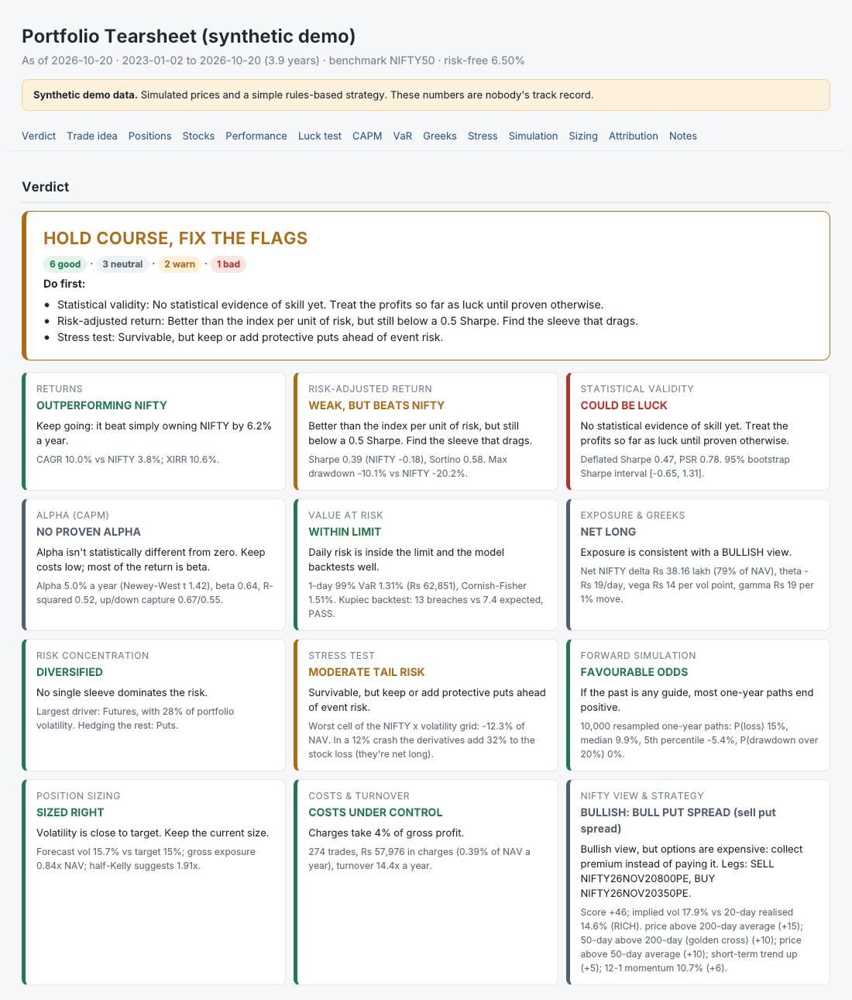
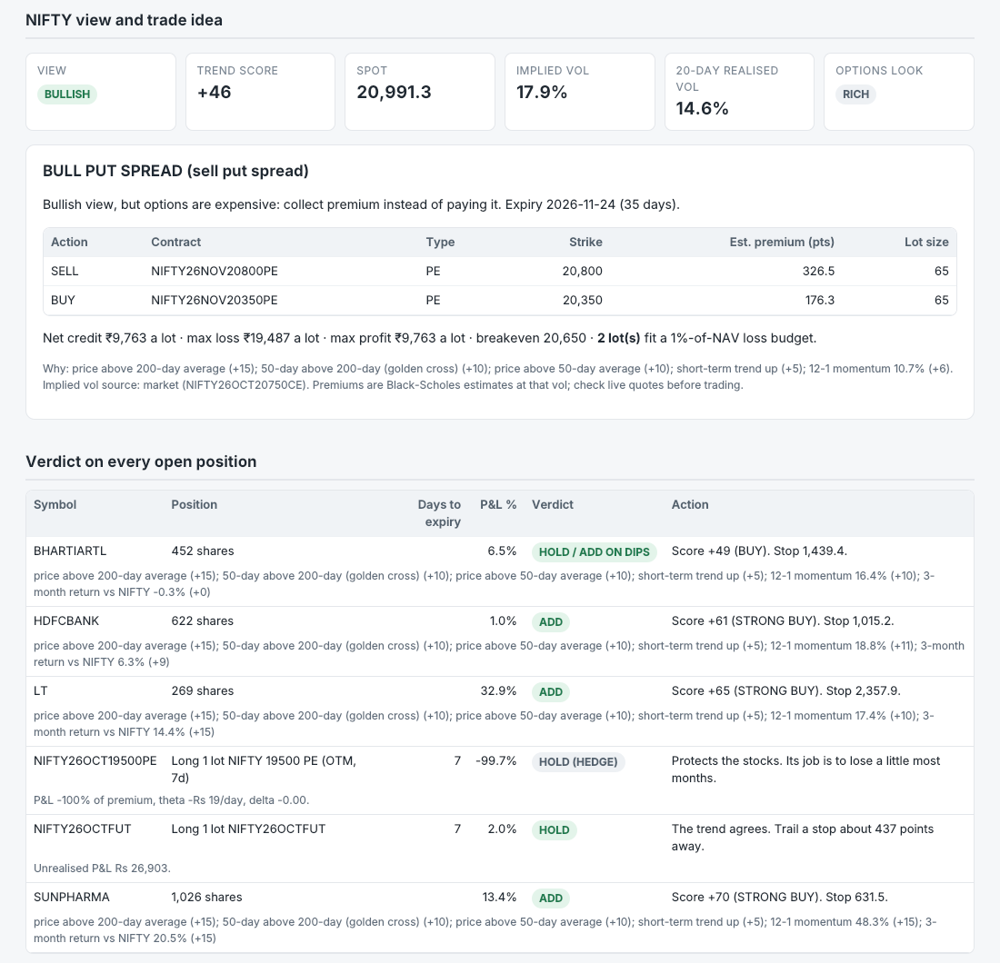

# NIFTY Portfolio Analytics

[](https://github.com/krishnanjain2276/portfolio-analytics/actions/workflows/tests.yml)


A trade ledger, risk engine and verdict engine for a personal portfolio of Indian stocks,
NIFTY futures and NIFTY options. Give it your trade history and it rebuilds the portfolio day by
day, measures performance and risk properly, and then says what it thinks you should do about it:
for every analysis, every open position and every stock you're watching.

[See the live demo tearsheet →](https://krishnanjain2276.github.io/portfolio-analytics/)
(synthetic data)



## Why I built this

I've traded Indian equities and NIFTY F&O since 2022, and the broker's P&L screen never answered
the questions I actually had. Was I beating the index, or just taking more risk? How much of a
crash would my puts really absorb? Could my results simply be luck? This project is my attempt to
answer those questions the way a risk desk would: correct accounting first, then the statistics,
then a clear decision at the end.

## Quick start

```bash
git clone https://github.com/krishnanjain2276/portfolio-analytics.git
cd portfolio-analytics
pip install -e ".[dev]"

portfolio-analytics demo     # synthetic data -> reports/tearsheet.html and an Excel workbook
pytest                       # 75 tests
```

`python -m portfolio_analytics ...` works too if you'd rather not install it.

> The demo data is synthetic. Prices are simulated (GARCH(1,1) with Student-t shocks for the
> index, a one-factor model for stocks) and the trades come from a deliberately simple
> rules-based strategy. None of the demo numbers are anyone's track record.

## What it does

| Area | What's computed | Why it matters |
|---|---|---|
| Ledger | Day-by-day positions, cash, NAV and per-instrument P&L. Futures are marked to market daily; options and futures cash-settle at expiry. | Everything downstream depends on the accounting. The tests check that NAV equals capital plus every instrument's P&L on every single day. |
| Returns | Time-weighted returns (deposits and withdrawals stripped out) and XIRR. | TWR measures the strategy; XIRR measures your own experience of it. |
| Risk-adjusted | Sharpe, Sortino, Calmar, Omega, drawdown episodes, monthly table. | The standard tearsheet. |
| Luck test | Probabilistic Sharpe, Deflated Sharpe, Minimum Track Record Length, bootstrap Sharpe interval. | The hardest question about any track record: could it be chance? |
| CAPM | Alpha and beta with Newey-West standard errors, information/Treynor/appraisal ratios, up/down capture, rolling beta. | Plain OLS t-stats overstate significance on autocorrelated daily data. |
| VaR / ES | Historical, Gaussian, Cornish-Fisher and EWMA VaR, Expected Shortfall, and a Kupiec backtest. | A VaR number means little until it's been backtested. |
| Options | Black-Scholes-Merton with dividend yield, implied vol by Brent's method, all five Greeks. | Delta-adjusted exposure and Greeks for the live book. |
| Risk decomposition | Euler split of portfolio volatility by position and sleeve. | Shows what actually drives risk, and what hedges it. |
| Stress tests | NIFTY move × implied-vol grid with full revaluation, plus named crash scenarios. | Captures option convexity that a delta approximation misses. |
| Simulation | 10,000 one-year paths by stationary block bootstrap. | Keeps the fat tails and volatility clustering of real returns. |
| Sizing | Half-Kelly, EWMA vol targeting, fixed-fractional lots, risk parity. | The mechanics behind "strict position sizing". |
| Attribution | P&L by sleeve and month, turnover, charges as a share of profit. | Where the money was made and lost. |

## Verdicts

Every verdict is a simple rule with its threshold in [`config.py`](portfolio_analytics/config.py),
and the report shows the numbers behind each one. **They are not investment advice.**

**The headline** is one of ON TRACK, HOLD COURSE AND FIX THE FLAGS, KEEP THE STRATEGY BUT CUT RISK
NOW, or RETHINK THE STRATEGY, followed by the first things to do.

**One verdict per analysis**

| Analysis | Possible verdicts | Rule |
|---|---|---|
| Returns | Outperforming NIFTY / Lagging NIFTY / Below risk-free | CAGR vs NIFTY and the T-bill rate |
| Risk-adjusted | Strong / Acceptable / Weak but beats NIFTY / Weak | Sharpe ≥ 1, ≥ 0.5, or vs NIFTY's |
| Luck test | Skill likely / Inconclusive / Could be luck | Deflated Sharpe ≥ 0.95 or ≥ 0.5 |
| CAPM | Genuine alpha / Negative alpha / Leveraged beta / No proven alpha | Newey-West alpha t ≥ 2; beta ≥ 1.2 |
| VaR | Within limit / Above limit (cut by X%) / Model unreliable | 99% VaR ≤ 3% of NAV; Kupiec result |
| Greeks | Net long, short or neutral; against the trend; high theta bleed | Net delta vs the NIFTY view; theta vs NAV |
| Concentration | Diversified / Concentrated (trim this sleeve) | Euler share of risk ≤ 40% |
| Stress | Well protected / Moderate tail risk / Hedge needed (with exact put lots) | Worst grid loss vs 15% of NAV |
| Simulation | Favourable odds / High chance of a losing year | P(losing year) ≤ 30% |
| Sizing | Sized right / Oversized (scale by X) / Undersized | Forecast vol vs a 15% target; half-Kelly |
| Costs | Under control / Overtrading / Losing before costs | Charges ≤ 30% of gross P&L |

**One verdict per open position**

* Stocks: ADD, HOLD, HOLD / ADD ON DIPS, TRIM or EXIT, with a stop.
* Futures: HOLD, HOLD WITH TIGHT STOP, CLOSE / REVERSE if the trend has turned, ROLL near expiry.
* Long options: HOLD, BOOK PROFIT at +50%, CUT LOSS at −50%, CLOSE if out of the money with five
  days left, LET EXPIRE if it's worth less than the charges, HOLD (HEDGE) or ROLL HEDGE.
* Short options: HOLD (THETA WORKING), BUY BACK once 70% is captured, STOP OUT, ROLL OR CLOSE.

**Stock signals.** Every stock in the price file (held or on the watch-list) gets a score from
−100 to +100: price against its 20/50/200-day averages, 12-1 momentum, three-month strength
against NIFTY, RSI timing, and penalties for deep drawdowns and extreme volatility. That becomes
BUY, BUY (staggered), WAIT, AVOID or SHORT if you don't own it, and comes with a stop, a 2:1 target,
and the quantity that risks 1% of NAV. The report lists every point that went into each score.

**The NIFTY trade idea.** The same score on NIFTY gives a view, and implied vol against realised
vol says whether options are cheap or expensive. Together they pick a strategy:

| | Options cheap or fair | Options expensive |
|---|---|---|
| Bullish | Buy a call (or long futures if strongly bullish) | Bull put spread |
| Bearish | Buy a put (or short futures if strongly bearish) | Bear call spread |
| No trend | Stay flat | Iron condor |

You get strikes, the next monthly expiry at least 15 days away, estimated premiums, net
debit or credit, max loss, breakevens, and the number of lots that fits a 1% loss budget.



## Using your own data

```bash
portfolio-analytics init --data my_data          # creates my_data/input.xlsx
```

Open `input.xlsx` and fill in two sheets: **Cashflows** (the first row is your starting capital)
and **Trades** (Date, Symbol, Side, Quantity, Price, with Fees optional). That's all you have to type:

* Symbols are decoded for you. `RELIANCE`, `reliance.ns`, `NIFTY26OCTFUT`, `NIFTY26OCT25000CE`
  and weekly symbols like `NIFTY26O2025000PE` are all understood. The expiry (last Thursday before
  September 2025, last Tuesday after) and lot size (50, 25, 75 or 65 depending on the contract date)
  are filled in, and common NIFTY 50 stocks get their sector automatically.
* Fees can be left blank. Brokerage, STT (including the October 2024 and April 2026 F&O rate
  rises), exchange charges, the SEBI fee, stamp duty and GST are estimated. Use the contract note
  figure when you have it.
* Futures and options prices are optional. Missing closes are modelled from NIFTY: futures at
  fair value, options with Black-Scholes at the implied vol of your own trade. Every modelled
  contract is listed in the report.
* Stock and index prices can be downloaded with `fetch-prices` (needs `pip install yfinance`).
  Add stocks to the **Watchlist** sheet to get a verdict on ones you don't own.

Other ways in:

```bash
portfolio-analytics add      --data my_data                        # asks for each trade, step by step
portfolio-analytics add      --data my_data --symbol NIFTY26NOV25000CE --side BUY --qty 2 --price 180
portfolio-analytics add-cash --data my_data --amount 500000 --date 2026-04-01
portfolio-analytics import   --data my_data --file tradebook.csv   # a broker export
portfolio-analytics fetch-prices --data my_data
portfolio-analytics validate --data my_data                        # plain-English data checks
portfolio-analytics run      --data my_data --trials 3
portfolio-analytics verdict  --data my_data                        # just the verdicts, in the terminal
```

`import` reads a Zerodha Console tradebook as it is, and most other broker exports too (if a column
isn't recognised, name it with `--map date='Trade Date' symbol=Scrip`). It converts F&O units to
lots, merges the partial fills of an order at their average price, understands both ISO and
day-first dates, and skips trades you've already entered.

`--trials` is how many versions of your strategy you tried before settling on this one. Be honest
about it: it's what the Deflated Sharpe Ratio uses to correct for cherry-picking.

Keep your own data private: `.gitignore` already excludes `my_data/` and all `.xlsx` files, so
your trades never end up on GitHub.

## How it fits together

The pipeline is: load and clean the data, replay it through the ledger, run the analytics on the
resulting returns and live book, then turn the results into verdicts and a report.


```
portfolio_analytics/
  config.py        every assumption and threshold in one place
  instruments.py   stocks, index, futures, options; NSE symbol decoding, expiries, lot sizes
  charges.py       Indian transaction-charge estimates
  data.py          loading and cleaning, modelled derivative prices, price download
  inputs.py        Excel template, add / fetch / validate
  tradebook.py     broker tradebook import
  portfolio.py     the ledger and time-weighted returns
  options.py       Black-Scholes, Greeks, implied vol
  performance.py   return statistics, PSR, DSR, MinTRL, bootstrap, XIRR
  risk.py          CAPM (Newey-West), VaR/ES, Kupiec, live-book Greeks, Euler, stress tests
  sizing.py        Kelly, vol targeting, fixed-fractional, risk parity
  montecarlo.py    block-bootstrap forward simulation
  attribution.py   P&L by sleeve, turnover, costs
  signals.py       stock scores, NIFTY view, options strategy builder
  verdicts.py      verdicts per analysis and per position, and the headline
  analysis.py      runs everything in order
  report.py        HTML tearsheet       charts.py   its charts
  excel.py         Excel workbook       demo.py     the synthetic dataset
  cli.py           the command line
tests/             75 tests (see below)
```

## Methodology notes

**Time-weighted return.** Flows arrive at the start of the day:
r_t = NAV_t / (NAV_{t−1} + F_t) − 1, annualised over 252 trading days.

**Sharpe.** Mean daily excess return over its standard deviation, × √252. The risk-free rate
defaults to 6.5% (roughly the 91-day T-bill); change it with `--rf`.

**Probabilistic Sharpe Ratio** (Bailey & López de Prado, 2012):
PSR = Φ( (SR − SR\*) √(n−1) / √(1 − γ₃·SR + (γ₄−1)/4 · SR²) ), using the per-period Sharpe,
skew γ₃ and kurtosis γ₄. Negative skew and fat tails lower the confidence.

**Deflated Sharpe Ratio** (Bailey & López de Prado, 2014): the PSR measured against the expected
best Sharpe of N strategies with no skill,
SR₀ = √V · [(1−γ)Φ⁻¹(1−1/N) + γΦ⁻¹(1−1/(Ne))], where γ is the Euler–Mascheroni constant.

**Newey-West.** HAC covariance with Bartlett weights and lag ⌊4(n/100)^{2/9}⌋.

**Cornish-Fisher VaR.** The normal quantile adjusted for skew S and excess kurtosis K:
z_cf = z + (z²−1)S/6 + (z³−3z)K/24 − (2z³−5z)S²/36.

**Kupiec test.** LR = −2 ln[ (1−p)^{T−x} p^x / (1−x/T)^{T−x} (x/T)^x ] ~ χ²(1), where x is the
number of breaches of a rolling 250-day historical VaR over T out-of-sample days.

**Euler decomposition.** With rupee exposures e (stocks are their own factor; futures and options
load on the index through delta) and covariance Σ, σ = √(eᵀΣe) and position i contributes
eᵢ(Σe)ᵢ / σ. The contributions add up to σ exactly.

**Stationary bootstrap** (Politis & Romano, 1994). Blocks of geometric length with a mean of 10
days, wrapping around the sample. Used for both the Sharpe interval and the simulation.

**Modelled option prices.** When an option has no close for a day, it's priced with Black-Scholes
at the implied vol of your most recent trade in that contract. Those marks are never used to
estimate market implied vol for the trade idea, since that would just return the assumption.

## Known simplifications

Listed here so you can raise them in an interview before someone else does.

- Futures margin and the interest on it are ignored; futures affect NAV only through P&L.
- All derivatives are treated as cash-settled European contracts. NSE stock options are physically
  settled, so extend the settlement step if you trade them.
- Black-Scholes assumes one constant volatility per option. The smile isn't modelled beyond each
  option having its own implied vol.
- Stress scenarios are stylised one-day shocks, not replays of history.
- Dividends on stocks aren't tracked separately; use total-return prices or enter them as trades.
- Taxes (STCG/LTCG) aren't modelled, only transaction charges.
- Expiry dates ignore exchange holidays. Put the exact date in the Instruments sheet if it matters.
- There's no high/low data, so the "ATR" used for stops is the average absolute daily close-to-close move.
- The verdicts are trend-and-risk rules. They know nothing about news, earnings, liquidity or your
  tax position.

## Tests

`pytest` runs 75 tests, and GitHub Actions runs them on Python 3.10 to 3.13 on every push, along
with a lint check and a full demo run. They cover:

* **Pricing:** put-call parity, implied-vol round trips, every Greek against finite differences.
* **Accounting:** NAV reconciles on every day; futures mark-to-market; option expiry settlement;
  average cost through partial sales; returns don't depend on portfolio size; idle cash earns nothing.
* **Statistics:** PSR, DSR and MinTRL agree with their formulas; Kupiec passes a good model and
  fails a bad one; Newey-West with no lags equals White's estimator; Euler contributions sum to σ;
  risk parity gives equal contributions.
* **Inputs:** symbol decoding, lot-size and expiry schedules, the STT change, tradebook import
  (lots, partial fills, duplicates, date formats), modelled prices, data validation.
* **Verdicts:** the strategy matrix, spread payoffs, position rules, and that every analysis and
  position gets a verdict.

## What I'd add next

- Bank Nifty and stock futures/options (the parser and lot-size table are the main changes)
- STCG/LTCG tax estimates, so returns can be shown after tax
- Historical stress scenarios (March 2020, June 2024 election day) alongside the stylised ones
- A volatility smile instead of one implied vol per option

## Licence

MIT. Nothing here is investment advice.
